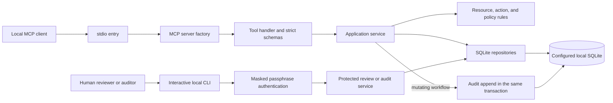

# System architecture

SecureOps MCP is a local simulation over wholly fictional resources. Its runnable MCP entry uses stdio and a selected SQLite file. The application has no cloud provider client or live resource mutation path. The [scope](scope.md) distinguishes this local entry from the configured HTTP viewer boundary, which has no runnable listener.

## Layers and trust boundaries

| Layer | Main modules | Responsibility |
| --- | --- | --- |
| Domain | `src/domain/resource.ts`, `change.ts`, `policy.ts`, `errors.ts` | Validate fictional resource, allowlisted action, and policy shapes; define typed operational failures. |
| Application | `src/application/*-service.ts`, `change-preview.ts`, `execution-preflight.ts` | Enforce caller capability, assess current state and policy, compose workflow transitions and audit writes. Pure previews and observations do not authorize a change. |
| SQLite infrastructure | `src/infra/sqlite/connection.ts`, `migrate.ts`, and repositories | Open the configured database, apply numbered migrations, bind SQL values, reconstruct validated records, and persist workflow and audit rows. Repositories are storage primitives, not actor authenticators. |
| Local MCP transport | `src/mcp/stdio.ts`, `server.ts`, `schemas.ts`, `tools/*` | Serve the local tool set through stdio, issue a local agent actor from validated configuration, validate tool contracts, and map operational errors to safe results. No MCP tool decides a review. |
| Human CLI | `src/cli/index.ts`, `commands/*`, `src/security/reviewer-auth.ts` | Parse explicit local database commands, challenge reviewers or auditors on an interactive terminal, and pass authenticated actors to protected services. |

The diagram shows two separate sources of authority. `createMcpServer` derives the MCP actor from a `loadConfig` result and registers the local tools; tool arguments cannot supply a reviewer identity. `authenticateCliActor` derives a reviewer or auditor actor only after the terminal credential challenge. The local `proposals:review` command reaches the decision service through that CLI path, while an MCP agent may only propose, request review, and later ask for simulated execution. See [permissions](permissions.md) and [CLI commands](cli.md).

## Configuration, injection, and connection lifetime

`loadConfig` validates the mode and resolves the selected database before a server or database opens. The local stdio entry supplies a server factory with trusted tool registration functions. Each SDK-created server receives its own configured SQLite connection and an issued local agent actor; the server's close handler closes that connection. The MCP factory accepts its connection as a dependency and verifies that its file and access mode match the validated configuration. Application services receive a connection, clock, ID generator, or policy loader where needed, which keeps their decisions local and deterministic when those dependencies are supplied explicitly.

CLI commands select an existing local database explicitly for protected review and audit operations, own and close their connections, and authenticate a human for each protected invocation. The HTTP demo configuration and read-only factory boundary do not make a writable HTTP workflow or a runnable listener. For command and mode details, see [local setup](local-setup.md) and [permissions](permissions.md).

## State and transaction ownership

The application service owns each workflow's immediate SQLite write transaction. Proposal creation reads the current resource, previews the allowlisted action, evaluates current policy, and inserts a draft with an audit event on the same connection. An exact draft replay returns its original identity without another creation event. Requesting approval rechecks the resource version and policy before moving that draft to `pending_approval`; the transition and audit append commit together.

An authenticated reviewer decision rechecks the pending proposal, enabled reviewer identity, expected resource version, and current policy. Approval also requires an eligible current preview. The decision row, proposal status, and audit event share one transaction. Rejection grants no execution authority. A new simulated execution checks the independent approved decision, current policy, eligible preview, and exact resource version inside its write transaction before updating only the targeted fictional resource. The resource version increments once; the execution row, proposal transition, and audit events commit with that update. An exact completed retry returns the saved result without another write or a new current-policy decision. See [workflow storage](workflow-storage.md) and [execution service](execution-service.md).

Repositories may use nested savepoints, but they do not turn a partial state change into a completed workflow. The application service's outer transaction owns the commit. Failed state transactions leave no completed execution or success event; any separate failure event needs a deliberate later transaction and must contain only fixed safe fields.

The [proposal workflow](workflow.md) names every permitted status transition and distinguishes storage-only paths from current caller-facing routes.

## Audit limits

The audit repository serializes a bounded canonical JSON payload, assigns the next sequence, and hashes each event with the previous stored hash. Application services construct the payload from fixed fictional IDs, statuses, and outcome codes; untrusted reasons, tags, credentials, paths, and thrown messages do not belong in it. Authenticated audit verification checks the sequence and hashes of rows currently present. A person who can rewrite the SQLite file can also rewrite the whole chain, and a removed tail cannot be detected without an external trusted head. The [audit storage contract](auth-audit-storage.md) describes the exact serialization and verification limits.
