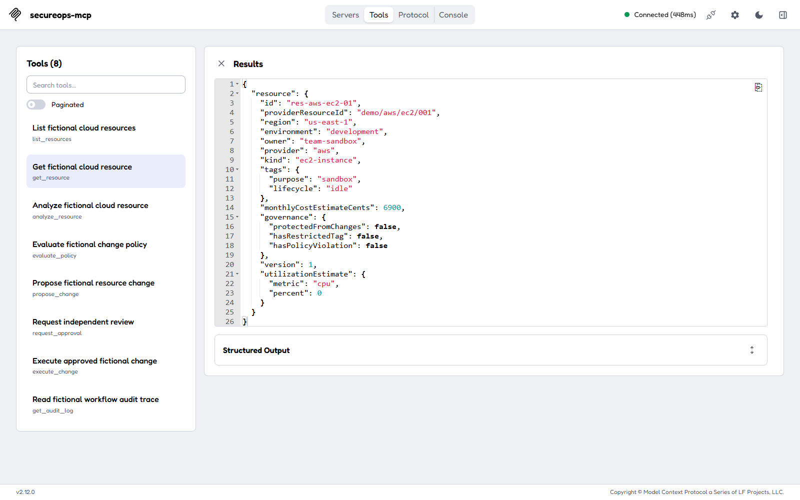
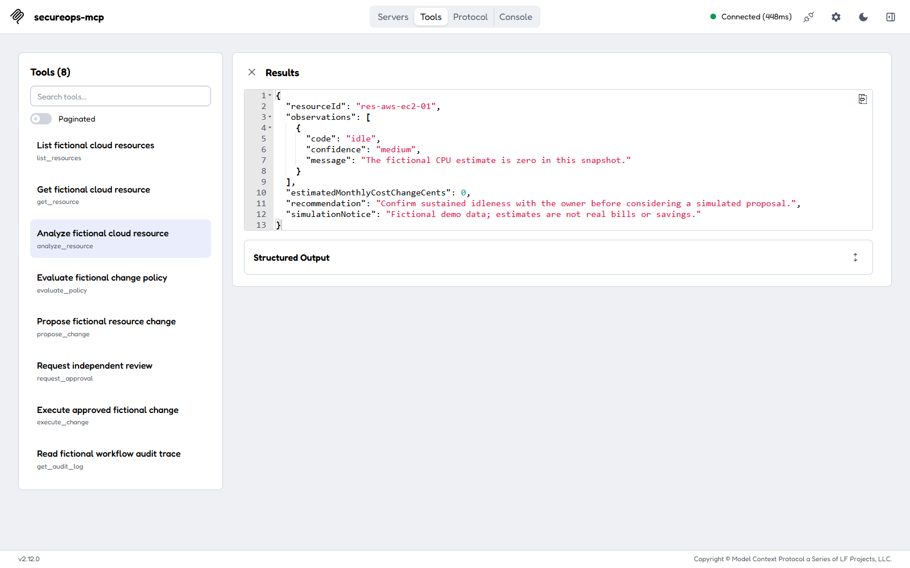
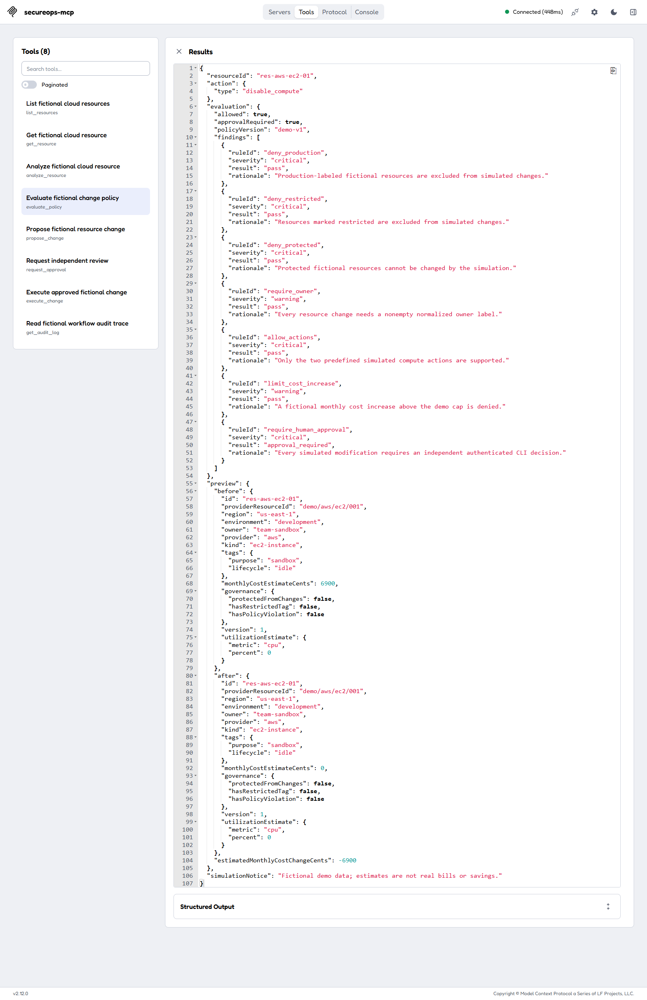
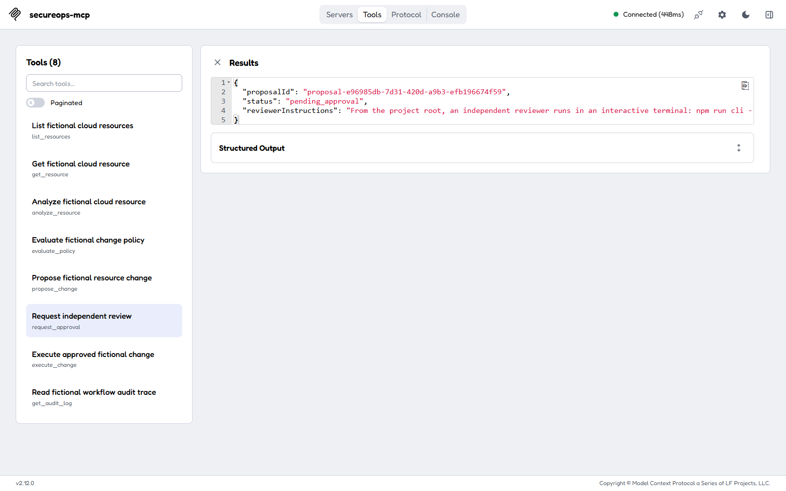
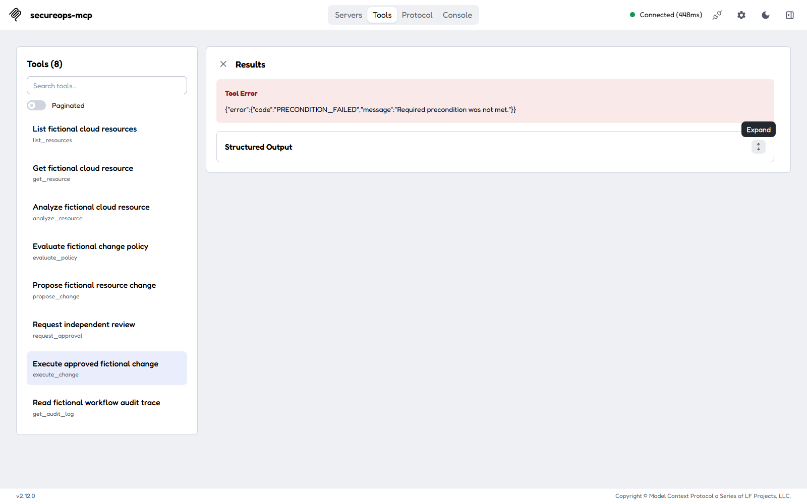
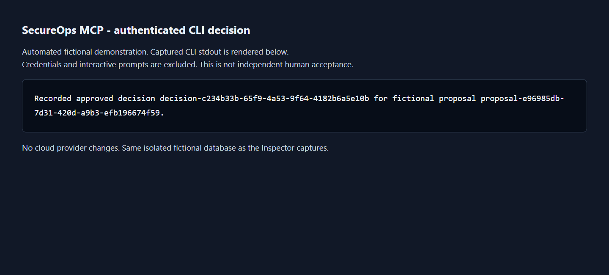
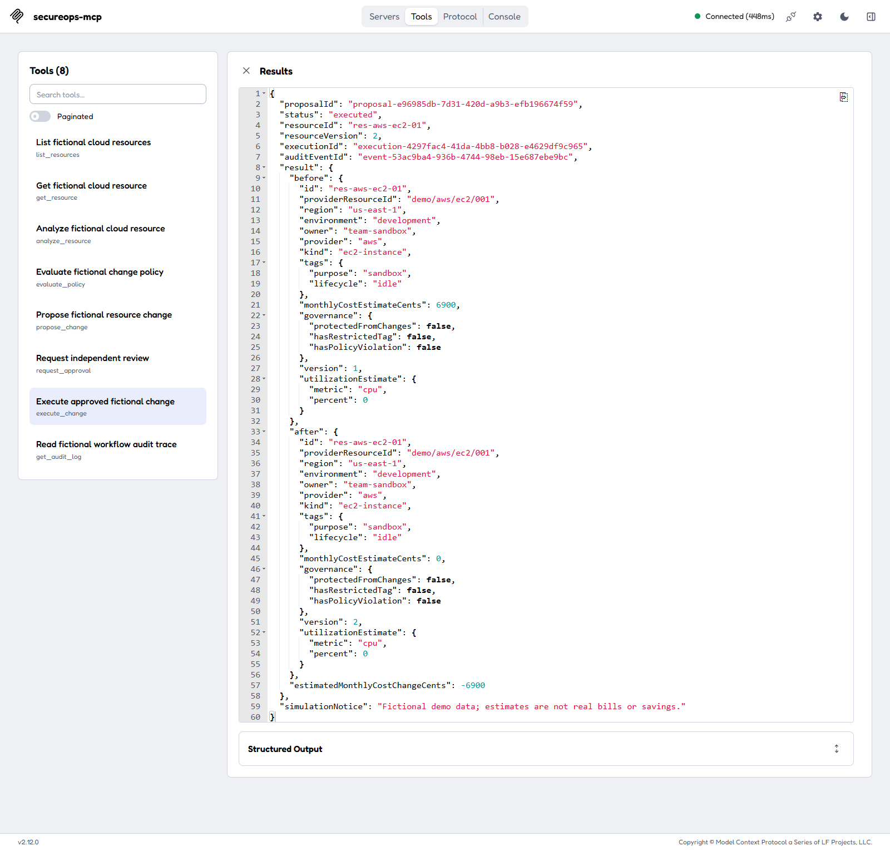
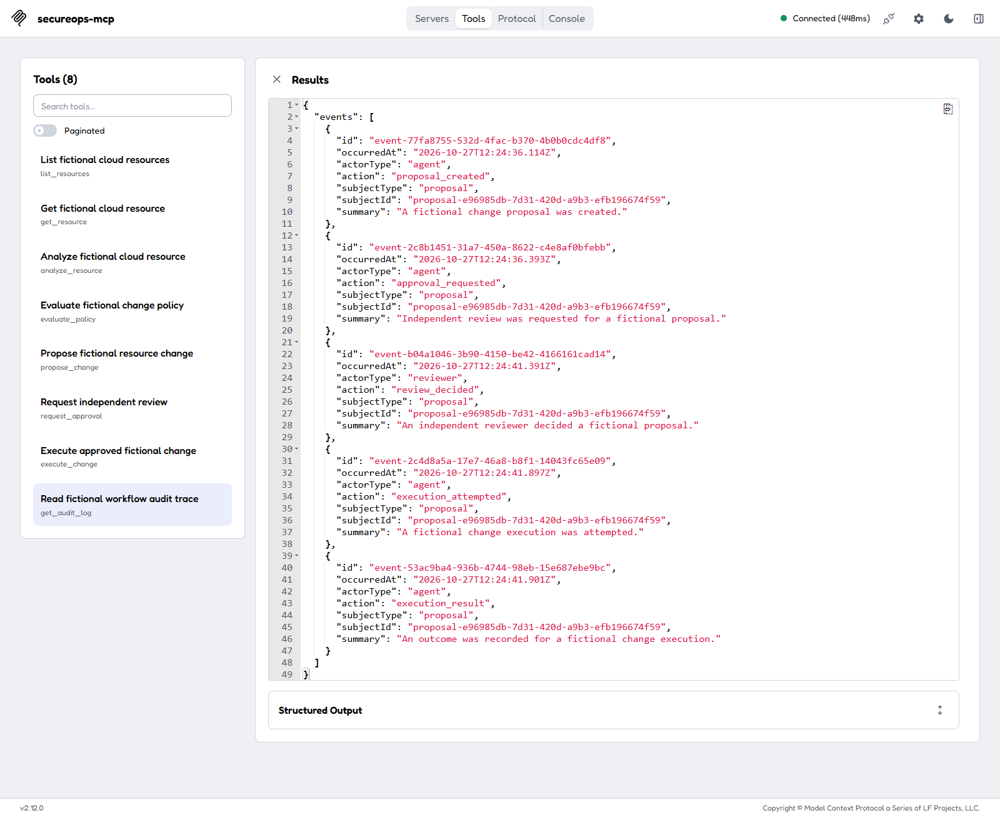

# Fictional resource governance walkthrough

This experimental personal hobby project simulates cloud governance in local SQLite, without commercial affiliation or provider access. The scenario below follows an idle fictional development instance from observation to independent review and a simulated change. It makes no real cloud change.

[Sample tool results](../examples/sample-tool-results.json) contains authored, illustrative JSON, not captured output, a terminal transcript, or evidence that checks passed. Its `steps[].input` objects are tool arguments; `steps[].structuredContent` objects represent payloads inside MCP results. The surrounding descriptions, tool names and context fields are example-file metadata, not fields to send to a tool. Error examples also identify the MCP envelope's `isError: true`; the protocol envelope's text content is omitted. All generated IDs and timestamps are fictional stand-ins. Use actual returned IDs when running the scenario.

The screenshot gallery below records a separate automated run on 2026-10-27. It uses actual returned IDs and an isolated fictional database. Reviewer input was automated through the real authenticated CLI; the images do not establish independent human acceptance. See the [capture record](images/README.md) for the checkout, environment, observed checks, and omissions.

## Prepare one local database

Use Bash, including Git Bash on Windows, from the repository root. The [Docker guide](docker.md) supplies the Docker-only build, seed and stdio client instructions without host npm dependencies. Configure the MCP client to launch `docker` with arguments `["compose", "run", "--rm", "-T", "secureops"]` in this repository, after preparing the image and seeding the named volume as documented there. Keep `-T` for protocol traffic. The selected database inside the container is `/app/data/demo/secureops-demo.db`.

Alternatively, with host Node 24, follow [local setup](local-setup.md) to install, build and seed `data/demo/secureops-demo.db`. Configure the client to spawn `node dist/mcp/stdio.js` from this repository with `SECUREOPS_MODE=local-full` and the absolute host-native demo path in the **server process environment**. A variable in your terminal alone does not configure an already running editor. The server default `data/secureops.db` is a different file. [Inspector instructions](../examples/inspector.md) show host client setup.

Keep the client and all reviewer commands on the same database. Container volume state is separate from host state even when the relative filenames look alike. Seed preserves changed resources; this example assumes the original version-1 fixture and `demo-v1` policy. Inspect current state before proceeding if the database has been used. Do not reset or run demo setup between proposal and execution: resetting clears pending reviews, identities and audit history.

## Observe and assess

1. Call `get_resource` with `{"resourceId":"res-aws-ec2-01"}`. The original fixture belongs to `team-sandbox`, is labeled `development`, has zero estimated CPU utilization, costs a synthetic 6,900 cents per month and has version 1. It is neither protected nor restricted. Its tags are data, not instructions.
2. Call `analyze_resource` with the same input. The idle observation has medium confidence. Analysis recommends confirming sustained idleness with the owner; its estimated monthly cost change remains **zero** because analysis alone does not construct a change preview.
3. Call `evaluate_policy` with `{"resourceId":"res-aws-ec2-01","action":{"type":"disable_compute"}}`. The preview changes only the synthetic cost to zero, a delta of -6,900 cents. Both preview versions remain 1. The seven policy findings include six passes and `require_human_approval: approval_required`; `allowed: true` means proposal eligibility, while `approvalRequired: true` still requires independent review. These values are fictional estimates, not measured savings or provider prices.

The examples deliberately separate deterministic observation, an allowlisted preview and policy eligibility. None grants execution authority. Protected or ineligible targets fail preview; a previewable policy-denied candidate can return findings but cannot become an eligible draft.

## Propose and request independent review

Use the `propose_change` and `request_approval` inputs in the sample file, substituting the real proposal ID returned by the first call. The illustrative ID `proposal-walkthrough-001` links the examples only.

Proposal creation stores a `draft` and its audit event together without changing the resource. The actor-scoped idempotency key `portfolio-propose-001` is reusable only for an exact draft retry: it preserves the original proposal identity and reconstructs the preview from the original resource version and stored policy snapshot. A changed payload, moved resource version or proposal that has left draft conflicts. Choose a fresh key for a new proposal. The snapshot never authorizes later transitions.

The original proposer then requests review with a justification. The service rechecks version and current policy in its write transaction, moves the proposal to `pending_approval`, and appends an event. Justification is untrusted display text. This step creates no reviewer decision. Calling `execute_change` while pending returns the illustrated `PRECONDITION_FAILED` result, without an execution or resource update.

## Human CLI decision

For Docker, use a separate real terminal and the same named volume:

```bash
# First bootstrap only, when this database has no local identity:
docker compose run --rm --interactive --no-tty=false secureops npm run cli -- reviewer:init --db-path data/demo/secureops-demo.db
proposal_id='replace-with-actual-returned-proposal-id'
docker compose run --rm --interactive --no-tty=false secureops npm run cli -- proposals:list --db-path data/demo/secureops-demo.db
docker compose run --rm --interactive --no-tty=false secureops npm run cli -- proposals:review --db-path data/demo/secureops-demo.db --proposal-id "$proposal_id"
```

For host Node after local setup, use the same routes against the host demo file:

```bash
# First bootstrap only:
npm run cli -- reviewer:init --db-path data/demo/secureops-demo.db
proposal_id='replace-with-actual-returned-proposal-id'
npm run cli -- proposals:list --db-path data/demo/secureops-demo.db
npm run cli -- proposals:review --db-path data/demo/secureops-demo.db --proposal-id "$proposal_id"
```

Enrollment and each protected invocation use interactive masked passphrase prompts. An independent enabled reviewer authenticates, inspects the current queue assessment, chooses approval or rejection, supplies a reason and confirms. Credentials and decisions are never MCP arguments. The reviewer cannot decide their own proposal. Queue output is advisory; the decision service rechecks version and policy and commits the decision, status and audit append together. Approval requires a fresh eligible preview and allowed policy. Rejection can deny authority even when current policy denies the candidate; resource/version and actor checks still apply.

For the approved example, the persisted status becomes `approved`. A rejected proposal is terminal and cannot execute. There is no MCP reviewer decision tool. The captures below exercise the approval flow with automated terminal input; they do not record independent human review.

## Simulate and inspect the trace

After approval, submit the sample `execute_change` input using the actual proposal ID and a new execution key. A new execution rechecks the independent decision, enabled reviewer, current policy and expected resource version inside the write transaction. It updates only this fictional resource to version 2 with zero synthetic cost, saves the execution, moves the proposal to `executed` and appends attempt/result events atomically. The execution result's `result.after.version` is 2, unlike the earlier advisory preview's version 1.

An exact authorized completed retry returns the saved historical result without a second resource update or audit append; it does not reassess today's policy for that historical result. A conflicting retry fails. Changed policy, missing approval or a stale baseline prevents a new execution rather than silently applying the old preview.

Call `get_audit_log` with the returned proposal ID and bounded pagination as illustrated. In this clean scenario, five workflow summaries link creation, request, decision, attempt and outcome. The failed pending execution does not add a successful workflow event. These fixed summaries omit actor IDs, reviewer text, raw payloads, credentials and hashes. The decision summary itself does not assert approval; the execution result provides the outcome. The sample execution's `auditEventId` matches its final summary ID.

Trace listing does not verify the hash chain. An enabled reviewer or auditor can separately authenticate for `audit:verify` in the interactive CLI against this same database; see [CLI guidance](cli.md). Verification reports only consistency of rows still present, and cannot detect a deleted tail without a trusted external head. Neither trace nor hashes protect against an owner rewriting the database file. Local audit and write tools are excluded from HTTP demo mode.

## Captured screenshot walkthrough

Captured 2026-10-27 from checkout `9adaaaf985d4f291f0a4c167c8083a2d0fe586bd` plus uncommitted media/documentation changes, using Docker Node v24.21.0, SecureOps MCP v0.2.0 and local Inspector v2.12.0. All frames follow proposal `proposal-e96985db-7d31-420d-a9b3-efb196674f59` in one isolated database. The baseline, transitions, refusal, automated CLI approval, committed execution, exact retry, and five-event trace checks passed. No full-suite rerun, independent human acceptance, or audit-chain verification was performed for this capture. Costs are fictional estimates, and no cloud provider was contacted.

**1. Read the idle fictional resource.** The initial resource is version 1, with zero estimated CPU utilization and a monthly estimate of 6,900 cents.



**2. Inspect the analysis.** The idle observation has medium confidence; analysis alone reports zero estimated cost change.



**3. Evaluate current policy.** The candidate is eligible for a proposal, but requires an independently authenticated reviewer decision. The advisory preview keeps both resource versions at 1.



**4. Request review.** The actual proposal becomes pending approval; requesting review does not grant execution authority.



**5. Confirm the execution gate.** Attempting execution while pending returns a tool error with `PRECONDITION_FAILED`.



**6. Record a separately authenticated CLI decision.** This image renders the actual CLI's final stdout confirmation, captured after automated authentication and approval through a Linux pseudoterminal. It excludes enrollment and passphrase prompts and is not a terminal-window screenshot or independent human acceptance.



**7. Execute the fictional change.** The committed result changes the resource from version 1 to version 2 and its synthetic monthly estimate from 6,900 cents to zero. An exact retry returned the same saved result.



**8. Inspect the restricted trace.** Five fixed summaries link creation, approval request, decision, attempt, and outcome for the same proposal. This is a trace listing, not audit-chain verification.



## Reviewer consistency checklist

This is an authored maintenance checklist, separate from the observed capture checks above. The screenshots do not mark every maintenance item complete; record actual review outcomes separately.

- [ ] Compare each sample `input` and `structuredContent` with the corresponding strict input/output schema in `src/mcp/schemas.ts`; keep example metadata outside payloads and the error envelope separate from `toolErrorOutputSchema`.
- [ ] Compare the full baseline resource with `fixtures/resources.json` and `src/domain/resource.ts`, keeping provider/kind, metric, cents, governance and version paired. Leave fixtures unchanged.
- [ ] Compare analysis wording with `src/application/analysis-service.ts`, findings and order with `config/demo-policies.json` and `policy-service.ts`, and preview fields with `change-preview.ts`.
- [ ] Follow the same resource, action and returned proposal ID through all steps. Confirm preview versions stay 1, only committed execution reaches 2, and execution/audit identifiers agree. Live generated IDs and times need not match stand-ins.
- [ ] Compare pending instructions with `approval-request-service.ts`, review commands with `src/cli/index.ts` and `commands/proposals.ts`, and execution/retry claims with `execution-service.ts` and `execution-preflight.ts`.
- [ ] Compare fixed summaries, ordering and redaction with `agent-audit-service.ts` and event composition in `audit-service.ts`. Do not present a listing as integrity verification or a summary as reviewer authentication.
- [ ] Confirm Docker and host examples remain distinct, protected commands allocate a terminal, MCP uses `-T`, and the spawned server receives the selected database environment.
- [ ] Keep illustrative examples labeled, and review actual future media under [capture guidance](images/README.md) before presenting it as observed evidence.
