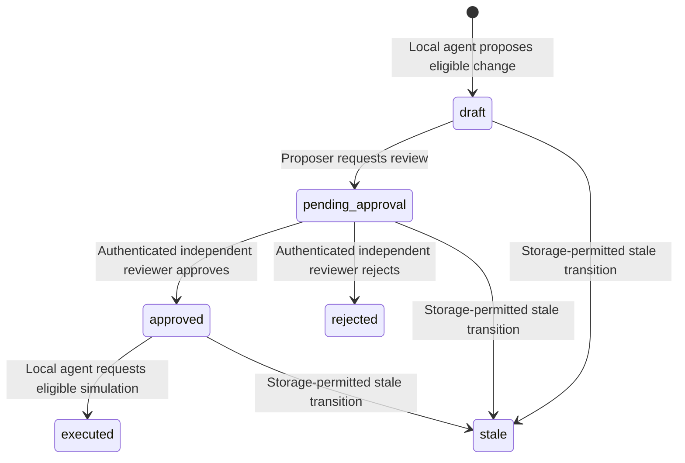

# Proposal workflow

This state machine describes changes to fictional resources in the selected local SQLite database. The status names and permitted transitions come from `proposalStatusSchema` and `allowedTransitions` in `src/infra/sqlite/proposal-repository.ts`. A storage-permitted transition is not authority to perform it: application services check the actor, current policy, resource version, and related records before committing a workflow change. See [system architecture](architecture.md) and [workflow storage](workflow-storage.md) for the layer and row contracts.

The three `stale` arrows are allowed by the repository's transition map, but no current caller-facing command or MCP tool marks a proposal stale. A resource version mismatch returns a conflict in the active services; it does not silently take a `stale` arrow. `rejected`, `executed`, and `stale` have no outgoing repository transitions. An MCP agent can request review, but only an independently authenticated human reviewer can move `pending_approval` to `approved` or `rejected`.

## Transition ownership

| From → to | Caller and application service | Required current checks and committed records |
| --- | --- | --- |
| No proposal → `draft` | Local MCP agent; `ProposalService.proposeChange` through `propose_change` | Issued `propose_change` capability, validated allowlisted action and current fictional resource, eligible preview and allowed current policy. Insert the draft and its audit event together. No resource version changes. |
| `draft` → `pending_approval` | Original proposer through local MCP `request_approval`; `ApprovalRequestService.requestApproval` | Issued capability and matching proposer, expected resource version, fresh eligible preview and allowed current policy. Store untrusted justification and append the audit event in the same transaction. No reviewer decision is created. |
| `pending_approval` → `approved` | Independently authenticated, enabled human reviewer through local `proposals:review`; `ReviewService.review` | Require `decide_proposal`, prevent self decision, recheck expected resource version, current eligible preview, and allowed current policy. Insert one approved decision, update status, and append audit together. |
| `pending_approval` → `rejected` | Independently authenticated, enabled human reviewer through local `proposals:review`; `ReviewService.review` | Require the same actor and pending-state checks and recheck resource version and current policy. A newly denied policy or ineligible preview does not block rejection. Insert one rejected decision, update status, and append audit together. |
| `approved` → `executed` | Local MCP agent through `execute_change`; `ExecutionService.executeChange` | Require `execute_change`, a coherent independent approved decision by an enabled reviewer, exact resource version, fresh eligible preview, allowed current policy, and no prior execution. Update only the targeted synthetic resource once, insert execution, move status, and append audit in one immediate transaction. |
| `draft`, `pending_approval`, or `approved` → `stale` | Repository permits these paths; no current caller-facing service invokes them | These are storage-only transitions. Current caller-facing mismatches fail without changing status. |

## Retries, denials, and state checks

An exact actor-scoped proposal retry while the original draft remains eligible returns its original proposal identity and reconstructs its result using the stored historical policy snapshot, without a second draft or creation event. The result does not expose the snapshot as a separate field. A different payload under the same idempotency key, a changed resource version, or a proposal that has left `draft` conflicts. The snapshot describes the original assessment and never authorizes a later approval or execution.

The reviewer queue is read-only and advisory. It shows pending requests after a fresh terminal passphrase challenge, but a later decision rechecks the proposal and resource inside its own write transaction. A matching status or reviewer ID in SQLite does not authenticate a person. Approval requires both an actual independent reviewer decision and current policy eligibility. Rejection is terminal and cannot be executed.

A new execution checks the approved decision, reviewer account state, policy contents, resource baseline, and unused proposal inside its immediate transaction. It increments the targeted resource version exactly once when the simulated change commits. An exact authorized retry of an already completed execution returns the saved result without a second resource or audit write and without applying today's policy to that historical result. A conflicting retry fails. The [execution service contract](execution-service.md) gives the precise retry checks.

Proposal creation, approval requests, decisions, and successful execution append only fixed, safe audit fields in the same SQLite transaction as their state changes. A rolled-back state change has no completed workflow event. Audit verification reports consistency of stored rows, not protection against a database owner rewriting the file or deleting the chain tail. See [audit storage](auth-audit-storage.md) for its limits.

## Documentation consistency contract

When changing this diagram or the architecture overview, compare the named statuses with `proposalStatusSchema` and every arrow with `allowedTransitions` in `src/infra/sqlite/proposal-repository.ts`. Leave terminal statuses without outgoing arrows, and label a repository-only transition separately from a route a caller can invoke. Check MCP tool names against `src/mcp/server.ts` and `src/mcp/stdio.ts`, and human review commands against `src/cli/index.ts`. A reviewer decision must always originate from the authenticated CLI path; no diagram or table should imply that an MCP agent can decide its own proposal. Keep exact retry and audit claims aligned with `ProposalService`, `ReviewService`, and `ExecutionService`. This prose contract is for maintaining the documentation; it is not a record that runtime checks passed.
